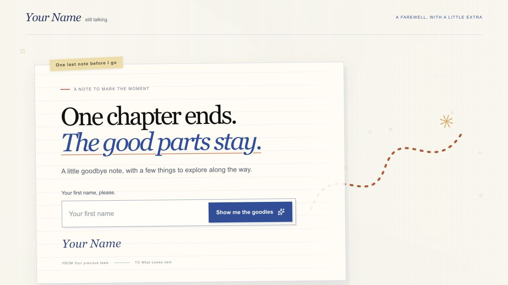
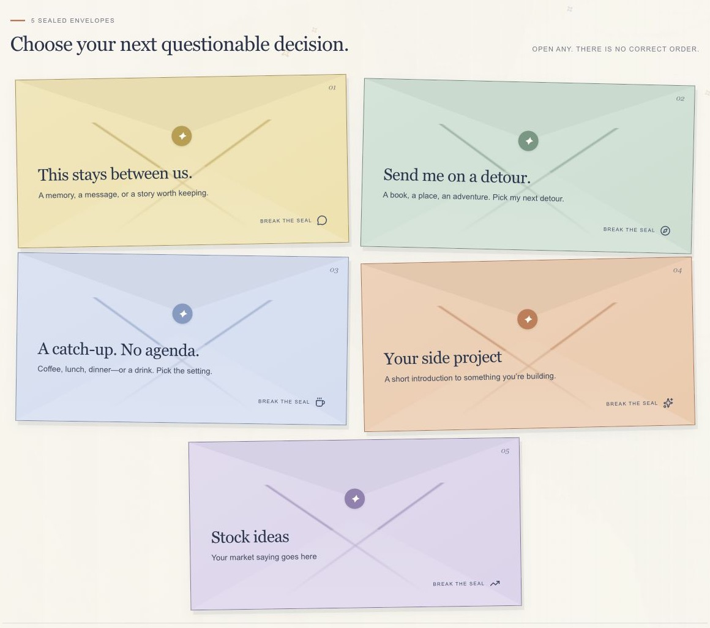
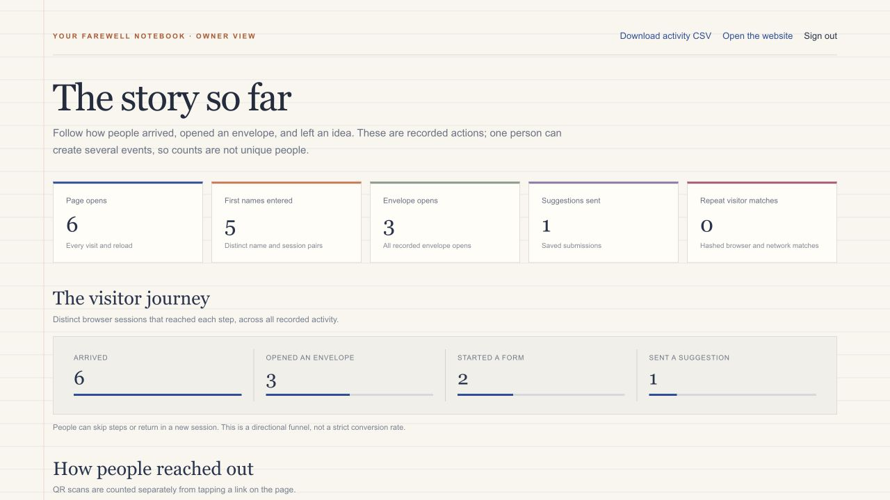
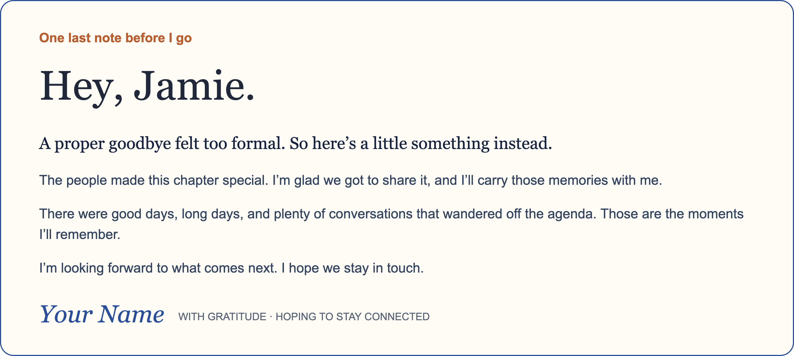

# Office Farewell Notebook

A customizable farewell microsite starter. It includes a personal note, optional recipient-specific paragraphs, playful suggestion forms, a downloadable note image, optional project and stock prompts, analytics, and a password-protected owner dashboard.

## Preview

The homepage, envelope selection, and owner dashboard below are screenshots of the running template. The dashboard uses fictional sample activity; it does not show data from the live farewell site.







This example note was exported from the running template using fictional sample content. It shows the image visitors can save from their own farewell page.



This is a generic, separate project. It contains no original farewell recipient list, private messages, production links, production credentials, or production database IDs. Create a new database and deployment for your own site. Never connect a public fork to somebody else's records.

## Quick start

Requirements: Node.js 22.13 or newer and pnpm 11.

```sh
pnpm install
cp .env.example .env.local
pnpm dev
```

Open `http://localhost:3000`. The local JSON store is useful for previewing the site, but it is not a shared or durable production database. The dashboard is at `/activity`; sign in at `/admin/login`.

## Make it yours

Edit `lib/site-config.ts` for the author, sign-off, opening/reflection/closing choices, envelope copy, links, optional project and stock prompt, analytics switch, and starting page-visit count. The visual layout is in `app/page.tsx` and `app/globals.css`.

`lib/greetings.ts` starts empty. Add a small set of private name-to-note entries only in a private working copy. If you publish that copy publicly, anyone can read those notes. Generic message options are in `lib/site-config.ts`.

Visitor activity analytics are on by default. The private activity page groups page views, name lookups, envelope opens, form starts, submissions, links, and downloads into visitor journeys. Set `analyticsEnabled` to `false` in `lib/site-config.ts` to turn this off. Forms collect the visitor's first and last name and suggestion content. The optional repeat-visitor fingerprint is a one-way HMAC of the network address and browser signature; raw IPs are not saved by this feature. Tell visitors what you collect and how to contact you before sharing your site.

## Choose a database

Set `DATABASE_PROVIDER` to exactly one value in `.env.local` for local development or in your hosting provider's secret settings for deployment:

| Value | Where data lives | Required setup |
| --- | --- | --- |
| `d1` | Cloudflare D1 | Create a database, run [`database/d1.sql`](database/d1.sql), and provide `CF_ACCOUNT_ID`, `CF_D1_DATABASE_ID`, and a scoped `CF_API_TOKEN` with D1 read/write access. The app talks to D1 over Cloudflare's HTTPS API, so the site itself can run on a Node.js host. |
| `firebase` | Cloud Firestore | Create a Firestore database, set the server-only `FIREBASE_SERVICE_ACCOUNT_JSON` secret, and apply [`database/firestore.rules`](database/firestore.rules). The server creates `messages` and `activity_events` collections as records arrive. |
| `supabase` | Supabase Postgres | Create a project, run [`database/supabase.sql`](database/supabase.sql), and provide `SUPABASE_URL` and the server-only `SUPABASE_SERVICE_ROLE_KEY`. |
| `local` | A JSON file in `.data/farewell.json` on this machine | Development and preview only. Do not deploy a serverless production site with this option; local files may be ephemeral and are not shared across instances. |

All adapters are included in the same repository; choose one with `DATABASE_PROVIDER`. Only set credentials for the provider you selected. Never add credentials to source files or commit `.env.local`.

## Admin password and email

Set `ADMIN_PASSWORD` and a unique random `ADMIN_SESSION_SECRET` (at least 32 characters) before deployment. `/activity`, its CSV export, and its clear-data action require the signed, HTTP-only admin cookie. The admin password is independent of Google or ChatGPT accounts. Use a password manager and keep both values private.

Email alerts are optional. Set `NOTIFY_EMAIL`, `RESEND_API_KEY`, and `RESEND_FROM_EMAIL` to send one HTML notification per new suggestion. The sender address must be verified with Resend. Without all three values, suggestions are stored and email status remains pending.

## Deploy

This is a full-stack Next.js app: the host must support Node.js and Next.js API routes, not static files alone. Deploy the repository to a Node-capable host (for example, a Next.js hosting platform or a Node server), set the selected database credentials and admin secrets in that host's environment settings, and use `pnpm build` / `pnpm start` as its build and start commands. Do not use `local` for production.

A static-only host cannot run these APIs or the admin dashboard without a separately hosted backend. The database provider is independent from the website host, but the app still needs a Node.js runtime for its API routes.

## Before sharing

1. Replace all sample copy and links.
2. Choose a production database and set its secrets.
3. Set a strong admin password and session secret.
4. If using personal notes, do not publish them in a public repository.
5. Preview on a phone and computer, submit a test suggestion, verify the dashboard and email, then clear test records.

See the step-by-step [user guide](USER_GUIDE.md). The project uses the MIT license; see [`LICENSE`](LICENSE).
